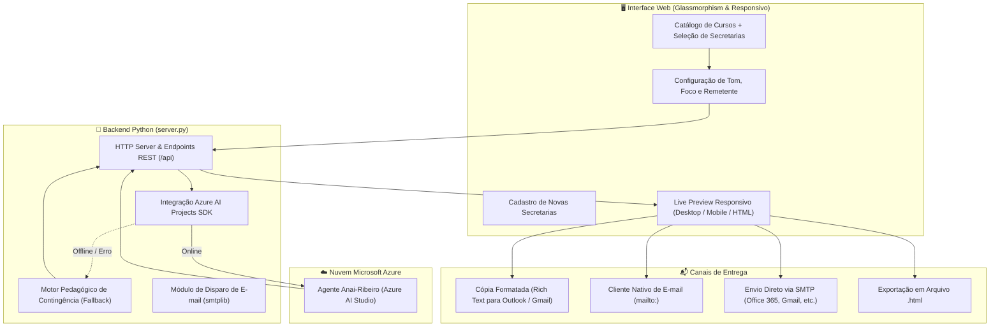

# 🎓 SENAI Conecta Educação — Agente Anai-Ribeiro 🏭

<p align="center">
  
  
  
  
  
</p>

---

## 📖 Visão Geral

O **SENAI Conecta Educação** é uma solução completa para aproximar as unidades do **SENAI** das **Secretarias Municipais e Estaduais de Educação (SEDUC e SME)** em todo o Brasil. 

A plataforma automatiza e qualifica o processo de prospecção e celebração de parcerias institucionais, utilizando o agente de inteligência artificial **Anai-Ribeiro** (hospedado no **Azure AI Projects**) para redigir propostas pedagógicas personalizadas, alinhadas à **BNCC**, ao **Novo Ensino Médio (Itinerário V)**, à **Educação Profissional e Tecnológica (EPT)** e aos índices educacionais (**IDEB**).

Além da geração de conteúdo com IA, o sistema disponibiliza um **Live Preview responsivo** com a identidade visual oficial do SENAI, permitindo cópia formatada (Rich Text) para **Outlook** e **Gmail**, acionamento via `mailto:`, disparo direto por **SMTP** e download do código HTML do e-mail.

---

## 🏛️ Arquitetura da Solução



---

## ✨ Principais Funcionalidades

### 1. 📚 Catálogo Dinâmico de Cursos SENAI
- Base completa em [`courses.json`](file:///c:/Users/09717590818/Desktop/Projeto-agente-Anai/projeto%20agente/courses.json) com cursos técnicos e qualificações nas áreas de maior demanda industrial:
  - 💻 **TI & Software**: Técnico em Desenvolvimento de Sistemas, Inteligência Artificial Aplicada, etc.
  - 🤖 **Indústria 4.0 & Automação**: Mecatrônica & Robótica Industrial, Manufatura Avançada.
  - ⚡ **Energia & Elétrica**: Eletrotécnica & Energias Renováveis (Solar Fotovoltaica).
  - 🧑‍🏫 **Capacitação Docente**: Letramento Digital e Metodologias Ativas para Professores.
  - 📊 **Gestão & Análise de Dados**: Power BI, Excel Avançado e Gestão da Produção.
  - ⚙️ **Mecânica CNC & Manufatura**: Operador e Programador de Usinagem CNC.
- **Filtros por categoria e busca instantânea** por palavras-chave em tempo real.
- **Seleções Rápidas**:
  - *Combo Novo Ensino Médio* (cursos de 1.200h estruturados para o Itinerário V).
  - *Combo Formação Docente* (capacitação continuada de professores da rede pública).
  - *Selecionar / Desmarcar Todos*.
- **Modal de Ementa Detalhada**: Carga horária, modalidade, competências desenvolvidas e benefícios específicos para a secretaria de educação.

### 2. 🏛️ Gestão de Secretarias de Educação
- Cadastro pré-configurado em [`secretarias.json`](file:///c:/Users/09717590818/Desktop/Projeto-agente-Anai/projeto%20agente/secretarias.json) com dados de gestores públicos:
  - **SEDUC-SP** (São Paulo - Estadual)
  - **SME-SP** (São Paulo - Municipal)
  - **SEED-PR** (Paraná - Estadual)
  - **SME Curitiba** (Paraná - Municipal)
  - **SEE-MG** (Minas Gerais - Estadual)
  - **SME Campinas** (São Paulo - Municipal)
  - **SME Ribeirão Preto** (São Paulo - Municipal)
- **Cadastro Dinâmico de Novas Secretarias**: Modal para inclusão de qualquer município ou estado, com persistência automática no `localStorage` do navegador.
- Preenchimento automático de pronomes de tratamento formais (*Prezado Secretário*, *Prezada Secretária*, *Vossa Excelência*).

### 3. 🤖 Redação de Propostas com IA (Agente Anai-Ribeiro)
- Integração nativa com o **Azure AI Projects SDK** conectando ao agente especializado **Anai-Ribeiro**.
- **Parâmetros Estratégicos Personalizáveis**:
  - **Foco da Proposta**: Novo Ensino Médio, Qualificação Profissional (EPT), Formação Docente ou Jovem Aprendiz Industrial.
  - **Tom de Comunicação**: Institucional Formal, Inovador & Tecnológico, Urgência / Vagas Limitadas ou Foco em Empregabilidade.
  - **Dados do Remetente**: Unidade SENAI, nome do consultor, cargo e contatos oficiais.
- **Geração Estruturada em JSON**:
  - Linha de Assunto atrativa e institucional.
  - Saudação e introdução protocolar.
  - Justificativa técnica e pedagógica (alinhamento com IDEB e BNCC).
  - Síntese de impacto dos laboratórios de ponta do SENAI.
  - Chamada para ação (CTA) para agendamento de audiência ou assinatura de convênio.
- **Mecanismo de Fallback Inteligente**: Caso a conexão com a nuvem Azure esteja indisponível, um motor pedagógico local assume instantaneamente, garantindo que o usuário nunca fique sem proposta.

### 4. ✉️ Live Preview Responsivo em Tempo Real
- Renderização visual imediata do e-mail oficial com layout padrão SENAI:
  - Cabeçalho institucional com marca oficial e número de protocolo gerado.
  - Banner oficial em alta definição dos laboratórios SENAI.
  - Cards formatados para cada curso selecionado (com carga horária, modalidade e badges de destaque).
  - Seção de benefícios da Gratuidade Regimental e Parcerias Públicas.
  - Botões de ação integrados (*Agendar Reunião Técnica*, *Solicitar Minuta de Convênio*).
  - Assinatura com os contatos da coordenação do SENAI.
- **3 Modos de Visualização**:
  - 🖥️ **Desktop**: Visão ampla simulando telas corporativas do Outlook.
  - 📱 **Mobile**: Moldura de smartphone simulando a leitura no aplicativo móvel.
  - 💻 **Código HTML**: Visualizador com destaque de sintaxe do código HTML pronto.

### 5. 🚀 Opções Flexíveis de Disparo e Compartilhamento
- 📋 **Copiar E-mail Formatado (Rich Text)**: Copia o layout renderizado com estilos CSS inline, tabelas e imagens para colar diretamente no corpo de um novo e-mail no Gmail, Outlook Web ou Outlook Desktop.
- ✉️ **Abrir no Outlook / E-mail (`mailto:`)**: Abre o cliente padrão configurado no sistema operacional com destinatário e assunto preenchidos.
- 🚀 **Disparo via Servidor SENAI (SMTP / API)**: Envio direto por conexão SMTP autenticada (TLS/STARTTLS). Se nenhum servidor SMTP for configurado, simula o protocolo oficial e salva o registro no histórico.
- 💾 **Baixar HTML**: Exporta o arquivo `.html` completo pronto para campanhas de mala direta.
- 📋 **Histórico e Auditoria Local**: Painel modal com todos os e-mails gerados e disparados, data/hora e status.

### 6. 🎨 Design Moderno & Experiência de Uso
- Design System institucional com as cores oficiais do SENAI (`#004785`, `#E31B23`).
- Efeitos visuais modernos em **Glassmorphism**, tipografias *Plus Jakarta Sans*, *Outfit* e *JetBrains Mono*.
- **Alternador de Tema (Dark Mode / Light Mode)** com persistência de preferência.

---

## 📁 Estrutura do Repositório

```text
Projeto-agente-Anai/
│
├── README.md                      # Documentação completa do projeto (este arquivo)
│
└── projeto agente/                # Diretório principal da aplicação
    ├── index.html                 # Interface web semântica e acessível
    ├── styles.css                 # Folha de estilos Vanilla CSS com temas Dark/Light
    ├── app.js                     # Lógica de interface, estado, preview e cópia rica
    ├── server.py                  # Servidor HTTP Python, rotas REST e orquestração IA
    ├── agente.py                  # Script de referência da conexão com Azure AI Projects
    ├── courses.json               # Catálogo estruturado de cursos do SENAI
    ├── secretarias.json           # Base inicial de Secretarias Estaduais e Municipais
    ├── iniciar.bat                # Script de execução rápida com 1 clique para Windows
    ├── README.md                  # Documentação local do submódulo
    ├── assets/                    # Recursos visuais e mídias
    │   └── banner_senai.jpg       # Banner institucional de alta resolução
    └── .venv/                     # Ambiente virtual Python com dependências instaladas
```

---

## 🚀 Como Executar o Projeto

### Pré-requisitos
- **Python 3.10** ou superior instalado no sistema.
- Navegador Web moderno (Google Chrome, Microsoft Edge, Firefox, Brave).

---

### Opção 1: Inicialização Rápida no Windows (Recomendada)

Basta dar um duplo clique no arquivo [`iniciar.bat`](file:///c:/Users/09717590818/Desktop/Projeto-agente-Anai/projeto%20agente/iniciar.bat) localizado na pasta `projeto agente`.

O script irá:
1. Detectar o ambiente virtual `.venv` ou o Python do sistema;
2. Iniciar o servidor HTTP Python na porta `5000`;
3. Conectar os endpoints do agente e da aplicação.

Abra seu navegador e acesse:
👉 **[http://localhost:5000](http://localhost:5000)**

---

### Opção 2: Pelo Terminal / PowerShell

Abra o PowerShell na pasta `projeto agente`:

```powershell
# 1. Navegue até o diretório da aplicação
cd "c:\Users\09717590818\Desktop\Projeto-agente-Anai\projeto agente"

# 2. (Opcional) Crie e ative um ambiente virtual caso ainda não possua
python -m venv .venv
.\.venv\Scripts\Activate.ps1

# 3. Instale as dependências da Azure AI
pip install "azure-ai-projects>=2.1.0" azure-identity

# 4. Inicie o servidor na porta 5000
python server.py 5000
```

Abra seu navegador em:
👉 **[http://localhost:5000](http://localhost:5000)**

---

## 🤖 Integração com Azure AI Projects (Agente Anai-Ribeiro)

O projeto se conecta ao agente de IA por meio da biblioteca oficial da Microsoft **`azure-ai-projects`**.

### Configuração do Agente no `server.py` e `agente.py`:
- **Endpoint**: `https://aula-agente-lucas-resource.services.ai.azure.com/api/projects/aula-agente-lucas`
- **Nome do Agente**: `Anai-Ribeiro`
- **Autenticação**: Gerenciada via `DefaultAzureCredential()` da biblioteca `azure-identity`.

### Autenticação no Azure:
Para conectar seu ambiente local ao agente no Azure, autentique-se via Azure CLI em seu terminal:
```bash
az login
```
*Observação: Se o ambiente não estiver autenticado ou a nuvem estiver indisponível, o sistema ativa automaticamente o **Motor de Fallback Pedagógico**, gerando propostas completas de alta qualidade sem interromper o fluxo de trabalho.*

---

## ⚙️ Configuração de Disparo por E-mail (SMTP)

A plataforma permite enviar e-mails diretamente pelo servidor utilizando credenciais SMTP seguras:

1. Na interface web, clique no botão **"⚙️ Configurar SMTP"** no cabeçalho;
2. Preencha as configurações do seu provedor:
   - **Servidor SMTP**: Ex: `smtp.office365.com` ou `smtp.gmail.com`
   - **Porta**: `587` (STARTTLS) ou `465` (SSL)
   - **Usuário / E-mail**: Seu e-mail institucional
   - **Senha / Senha de Aplicativo**: Senha de acesso ou app password gerada
3. Clique em **"Salvar Configurações"**.

> [!TIP]
> Caso prefira não configurar SMTP, você pode usar o botão **"Copiar E-mail Formatado"** para colar o layout com 100% de fidelidade visual dentro do Gmail ou Outlook, ou usar o botão **"Abrir no Outlook (`mailto:`)"**.

---

## 📡 Referência dos Endpoints da API

O arquivo [`server.py`](file:///c:/Users/09717590818/Desktop/Projeto-agente-Anai/projeto%20agente/server.py) provê as seguintes rotas REST:

| Método | Endpoint | Descrição |
|---|---|---|
| `GET` | `/api/status` | Retorna o status operacional do backend e informações do agente Azure. |
| `GET` | `/api/courses` | Retorna o catálogo completo de cursos do SENAI cadastrados em JSON. |
| `GET` | `/api/secretarias` | Retorna a lista de Secretarias de Educação cadastradas. |
| `POST` | `/api/generate-proposal` | Envia o contexto (secretaria, cursos, foco, tom) para o Agente Anai-Ribeiro e retorna a redação oficial em JSON. |
| `POST` | `/api/send-email` | Dispara o e-mail via SMTP ou registra o protocolo de envio simulado. |
| `GET` | `/*` | Entrega os arquivos estáticos da interface web (`index.html`, `styles.css`, `app.js`, etc.). |

---

## 🛠️ Tecnologias Utilizadas

- **Linguagem Backend**: [Python 3.10+](https://www.python.org/)
- **Serviço de IA**: [Azure AI Projects](https://learn.microsoft.com/azure/ai-studio/) & [Azure AI Agent Service](https://learn.microsoft.com/azure/ai-studio/concepts/agent-architecture)
- **SDKs Cloud**: `azure-ai-projects`, `azure-identity`
- **Frontend**: HTML5 Semântico, Vanilla JavaScript (ES6+), Vanilla CSS3 (Custom Properties & Glassmorphism)
- **Tipografia**: Google Fonts (*Plus Jakarta Sans*, *Outfit*, *JetBrains Mono*)
- **Padronização de E-mail**: Tabelas responsivas com CSS inline compatíveis com Outlook (Word Rendering Engine) e navegadores móveis.

---

## 👥 Autoria & Desenvolvimento

Projeto desenvolvido por **Anai Melinsky** para modernização e automação da divulgação educacional do **SENAI** para gestores públicos de educação.

---

## 📄 Licença

Este projeto é desenvolvido para fins educacionais e institucionais vinculados ao ecossistema SENAI e Microsoft Azure AI.